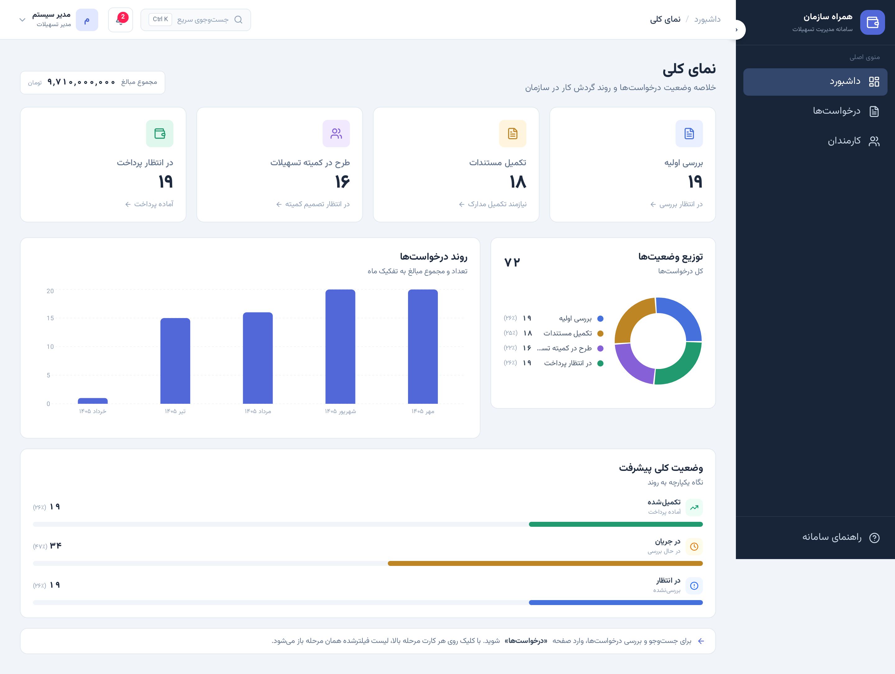
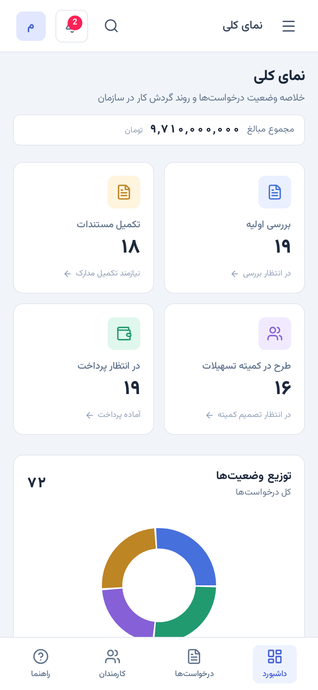
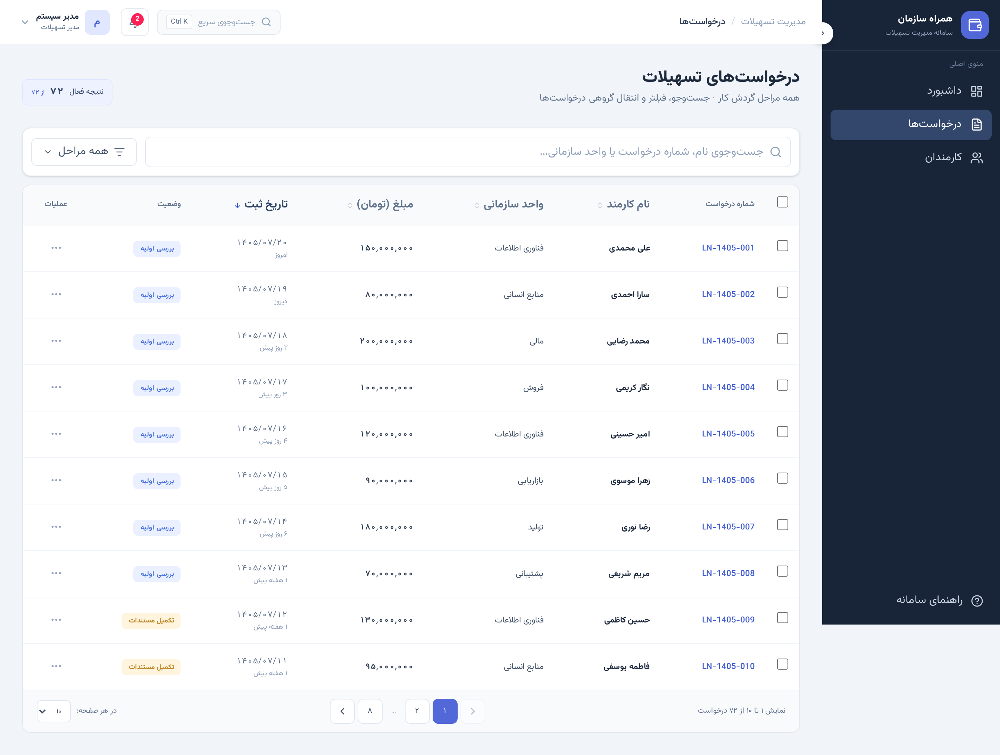
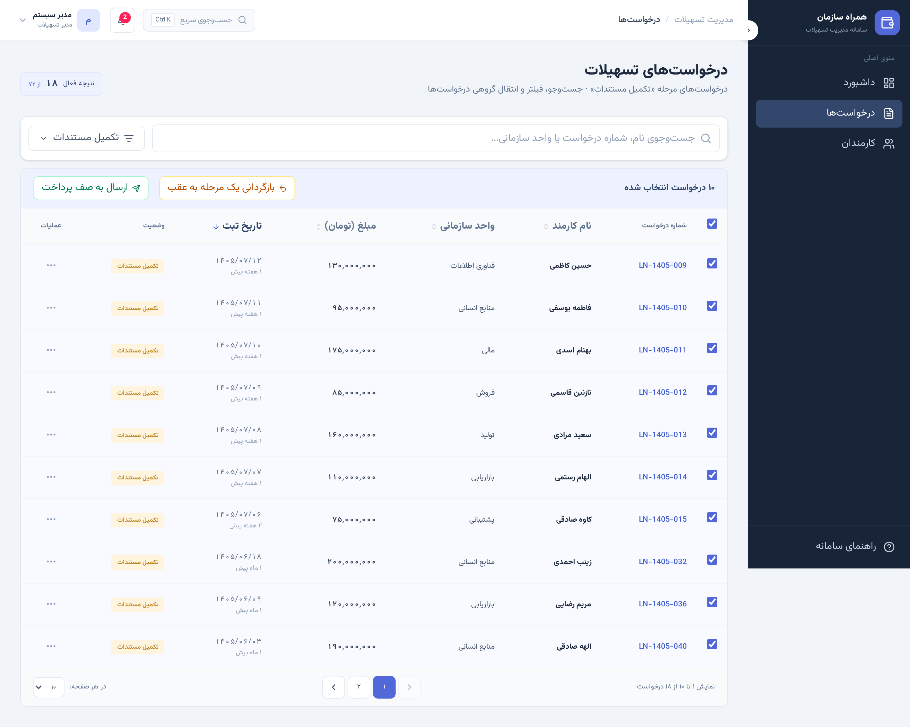
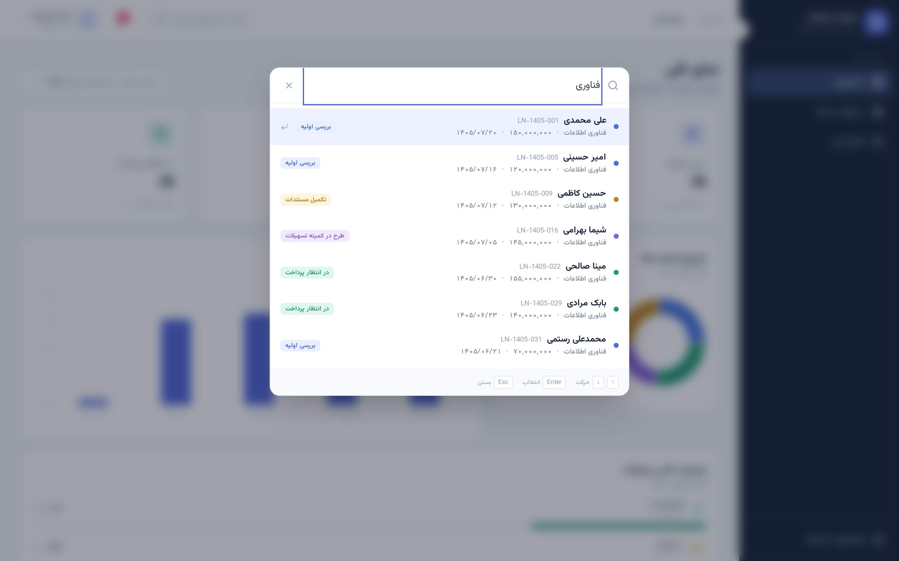
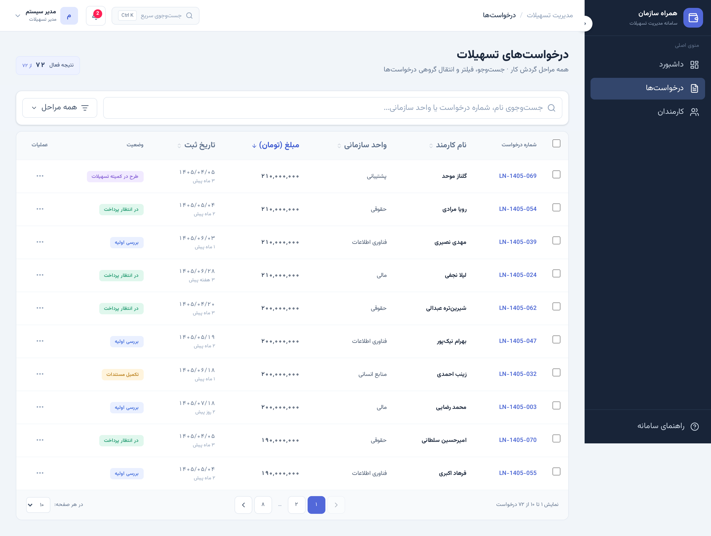
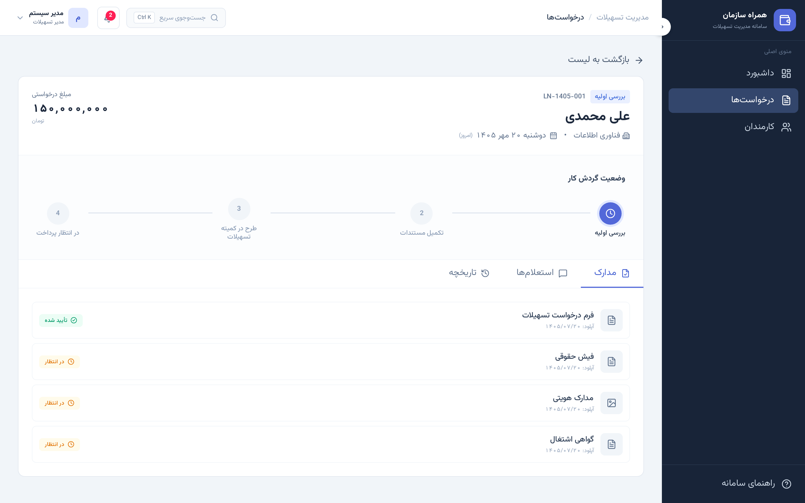

<div align="right">

# پنل راهبری سامانه مدیریت تسهیلات

سامانه‌ی مدیریت و راهبری درخواست‌های تسهیلات کارکنان — طراحی‌شده برای واحد منابع انسانی به‌عنوان مدیر سامانه.

**سازنده:** محسن تقی پور

</div>

---

## فهرست

- [معرفی](#معرفی)
- [قابلیت‌ها](#قابلیت‌ها)
- [تکنولوژی‌ها](#تکنولوژیها)
- [ساختار پروژه](#ساختار-پروژه)
- [توضیح فایل‌ها](#توضیح-فایلها)
- [تصمیم‌های فنی](#تصمیمهای-فنی)
- [راه‌اندازی](#راهاندازی)
- [آزمون کیفیت](#آزمون-کیفیت)
- [تصاویر](#تصاویر)

---

## معرفی

این پنل یک ابزار **راهبری** است، نه ابزار گردش کار. پنل در مسیر حرکت خودِ درخواست قرار ندارد؛ امکان **رصد، بررسی و تغییر مسیر** درخواست‌ها را برای مدیر سامانه فراهم می‌کند.

جریان کار تسهیلات از ثبت درخواست کارمند آغاز می‌شود، توسط واحدهای ذی‌نفع بررسی می‌گردد، در کمیته تسهیلات تصمیم‌گیری می‌شود و نهایتاً به صف پرداخت می‌رسد. این پنل بر چهار وضعیت زیر نظارت دارد:

| ترتیب | وضعیت | رنگ | شرح |
|:---:|---|:---:|---|
| ۱ | بررسی اولیه | آبی | درخواست ثبت شده و در انتظار بررسی اولیه است |
| ۲ | تکمیل مستندات | کهربایی | مدارک ناقص است و نیازمند تکمیل توسط کارمند |
| ۳ | طرح در کمیته تسهیلات | بنفش | در انتظار تصمیم‌گیری کمیته |
| ۴ | در انتظار پرداخت | سبز | تصویب شده و در صف پرداخت قرار دارد |

---

## قابلیت‌ها

### ۱. رصد و تفکیک
- نمایش **هر چهار وضعیت در یک صفحه** با تعداد درخواست در هر مرحله
- نمودار حلقه‌ای توزیع وضعیت‌ها
- نمودار میله‌ای روند ماهانه (بر پایه تقویم شمسی)
- نوار پیشرفت وضعیت کلی گردش کار
- نمایش مجموع مبالغ درخواستی

### ۲. جست‌وجو، فیلتر و مرتب‌سازی
- جست‌وجو بر اساس نام کارمند، شماره درخواست و واحد سازمانی
- **پشتیبانی از ارقام فارسی و عربی** — تایپ `۱۴۰۵` و `1405` هر دو `LN-1405-…` را پیدا می‌کنند
- فیلتر بر اساس وضعیت (یکپارچه با کارت‌های داشبورد)
- مرتب‌سازی چهار ستون: نام کارمند، واحد سازمانی، مبلغ، تاریخ
- **جست‌وجوی سریع سراسری** با میان‌بر `Ctrl + K` (`Cmd + K` در مک)
- صفحه‌بندی با شماره‌های فارسی و فاصله‌گذاری هوشمند (`۱ ۲ ۳ … ۸`)
- انتخاب تعداد ردیف در هر صفحه (۱۰ / ۲۰ / ۵۰)

### ۳. عملیات روی درخواست
- **مشاهده درخواست** — شامل مدارک، استعلام‌ها و تاریخچه کامل گردش کار
- **بازگردانی به مرحله قبل** — بازگرداندن درخواست به مرحله پیشین
- **انتقال به مرحله دلخواه** — جابه‌جایی مستقیم بین مراحل گردش کار

### ۴. عملیات گروهی
با انتخاب بیش از یک درخواست، نوار عملیات گروهی فعال می‌شود:
- بازگردانی گروهی یک مرحله به عقب
- ارسال گروهی به صف پرداخت

> اگر همه درخواست‌های انتخاب‌شده در اولین مرحله باشند، دکمه بازگردانی به‌درستی غیرفعال می‌شود و دلیل آن به کاربر اعلام می‌گردد.

### ۵. نکات طراحی و کیفیت
- **تقویم همسایه** — همه تاریخ‌ها با تقویم رسمی شمسی و ارقام فارسی
- رابط کاملاً فارسی و **راست‌به‌چپ (RTL)**
- **ریسپانسیو** — آزموده‌شده روی iPhone SE، iPhone 14 و iPad
- دسترس‌پذیری — کنترل کامل با کیبورد، برچسب‌های `aria` فارسی، هدف لمسی مناسب موبایل
- **بدون هیچ خطا یا هشداری در کنسول مرورگر**

---

## تکنولوژی‌ها

| کتابخانه | نسخه | کاربرد |
|---|---|---|
| **React** | ۱۹ | رابط کاربری — مبتنی بر کامپوننت و هوک |
| **TypeScript** | ۶ | تایپ‌دهی ایستا و ایمنی نوع |
| **Vite** | ۸ | ابزار ساخت و سرور توسعه با HMR سریع |
| **Tailwind CSS** | ۴ | استایل‌دهی utility-first |
| **Recharts** | ۳ | نمودارها — بر پایه SVG، واکنش‌گرا |
| **Lucide React** | ۱ | مجموعه آیکون |
| **Oxlint** | ۱ | لینتر سریع |

### نمودارها و کتابخانه گرافیکی

برای نمودارها از **Recharts** استفاده شده است — یک کتابخانه نمودار سازگار با React که نمودارها را به‌صورت SVG تولید می‌کند.

| نمودار | فایل | نوع | کاربرد |
|---|---|---|---|
| توزیع وضعیت‌ها | `charts/DonutChart.tsx` | حلقه‌ای (Donut) | نسبت هر مرحله از کل درخواست‌ها |
| روند درخواست‌ها | `charts/BarChart.tsx` | میله‌ای (Bar) | تعداد و مجموع مبالغ به تفکیک ماه شمسی |
| وضعیت کلی پیشرفت | `charts/ProgressChart.tsx` | نوار پیشرفت | درصد تکمیل‌شده، در جریان و در انتظار |

> **چرا Recharts؟** — سبک و واکنش‌گرا است، با React هم‌بومی است (کامپوننت‌محور)، خروجی SVG تولید می‌کند و به‌طور بومی از راست‌به‌چپ پشتیبانی می‌کند.

---

## ساختار پروژه

```
tas-hilat-admin/
├── index.html                    نقطه ورود HTML، تنظیم lang="fa" و dir="rtl"
├── package.json                  اسکریپت‌ها و وابستگی‌ها
├── vite.config.ts                پیکربندی Vite و Tailwind
├── tsconfig.*.json               پیکربندی TypeScript
├── .oxlintrc.json                قوانین لینتر
│
├── screenshots/                  تصاویر دسکتاپ و موبایل
│   ├── desktop-*.png
│   └── mobile-*.png
│
├── public/
│   └── favicon.svg               آیکون سایت
│
└── src/
    ├── main.tsx                  نقطه ورود React — رندر اپلیکیشن
    ├── App.tsx                   چیدمان صفحات و میان‌بر Ctrl+K
    ├── index.css                 متغیرهای CSS، فونت و تم پایه
    │
    ├── types/
    │   ├── request.ts            مدل داده درخواست، وضعیت‌ها و مرتب‌سازی
    │   └── page.ts               شناسه و عنوان صفحات
    │
    ├── utils/
    │   ├── jalali.ts             تقویم همسایه — تبدیل و قالب‌بندی تاریخ
    │   └── formatAmount.ts       جداکننده هزارگان و ارقام فارسی
    │
    ├── data/
    │   └── requests.ts           داده نمونه و پیکربندی مراحل گردش کار
    │
    ├── hooks/
    │   └── useLoanRequests.ts    مغز برنامه — داده، فیلتر، سرچ، مرتب‌سازی، صفحه‌بندی
    │
    ├── pages/
    │   ├── DashboardPage.tsx     صفحه نمای کلی و گزارش‌ها
    │   ├── RequestsPage.tsx      صفحه فهرست درخواست‌ها (کار روزمره)
    │   └── PlaceholderPage.tsx   قالب مشترک صفحات در حال توسعه
    │
    └── components/
        ├── layout/
        │   ├── AppShell.tsx      پوسته اصلی — چیدمان سایدبار و محتوا
        │   ├── Sidebar.tsx       منوی کناری دسکتاپ
        │   ├── Topbar.tsx        نوار بالا — بردکرامب و جست‌وجوی سریع
        │   └── BottomNav.tsx     ناوبری پایین موبایل
        │
        ├── ui/
        │   ├── Pagination.tsx    صفحه‌بندی با ارقام فارسی
        │   ├── SearchInput.tsx   ورودی جست‌وجو با شمارنده نتایج
        │   ├── QuickSearch.tsx   جست‌وجوی سریع سراسری (Ctrl+K)
        │   ├── FilterButton.tsx  منوی فیلتر وضعیت
        │   ├── PageHeader.tsx    سربرگ استاندارد صفحات
        │   ├── NotificationDropdown.tsx
        │   └── ProfileDropdown.tsx
        │
        └── dashboard/
            ├── StatsGrid.tsx        کارت‌های چهار وضعیت
            ├── RequestsTable.tsx    جدول دسکتاپ و کارت موبایل
            ├── RequestDetail.tsx    صفحه جزئیات با تب‌های مدارک/استعلام/تاریخچه
            ├── RequestActions.tsx   منوی عملیات هر درخواست
            ├── BulkBar.tsx          نوار عملیات گروهی
            ├── StatusTimeline.tsx   نمایش مراحل گردش کار در جزئیات
            ├── DashboardCharts.tsx  چیدمان نمودارها
            └── charts/
                ├── DonutChart.tsx
                ├── BarChart.tsx
                └── ProgressChart.tsx
```

---

## توضیح فایل‌ها

### لایه داده و منطق

| فایل | توضیح |
|---|---|
| `hooks/useLoanRequests.ts` | **مغز برنامه.** تمام منطق داده در یک جا: فیلتر وضعیت، جست‌وجو (با پشتیبانی ارقام فارسی)، مرتب‌سازی، صفحه‌بندی، انتخاب گروهی، انتقال و بازگردانی درخواست. وقتی بک‌اند اضافه شود فقط همین فایل تغییر می‌کند و رابط کاربری دست‌نخورده می‌ماند. |
| `data/requests.ts` | تعریف مراحل گردش کار و رنگ هر وضعیت، به‌همراه ۷۲ درخواست نمونه (۳۰ دستی + ۴۲ تولیدشده) برای شبیه‌سازی حجم واقعی. |
| `types/request.ts` | مدل داده `LoanRequest`، وضعیت‌ها، اسناد، استعلام‌ها و انواع مرتب‌سازی. |
| `types/page.ts` | شناسه و عنوان فارسی صفحات برای بردکرامب. |

### ابزارها

| فایل | توضیح |
|---|---|
| `utils/jalali.ts` | تبدیل و قالب‌بندی تاریخ همسایه. خروجی‌ها: `۱۴۰۵/۰۷/۲۰`، `۲۰ مهر ۱۴۰۵`، `دوشنبه ۲۰ مهر ۱۴۰۵` و زمان نسبی (`امروز`، `۳ روز پیش`). |
| `utils/formatAmount.ts` | جداکننده هزارگان با ارقام فارسی (`۱۵۰,۰۰۰,۰۰۰`) و تبدیل ارقام. |

### صفحات

| فایل | توضیح |
|---|---|
| `App.tsx` | مدیریت صفحه فعال، نمایش درخواست انتخاب‌شده و میان‌بر سراسری `Ctrl+K`. |
| `pages/DashboardPage.tsx` | نمای کلی: کارت‌های چهار وضعیت و نمودارها. کلیک روی هر کارت، لیست فیلترشده همان مرحله را باز می‌کند. |
| `pages/RequestsPage.tsx` | صفحه کار روزمره: نوار چسبان جست‌وجو، جدول، عملیات گروهی و صفحه‌بندی. |
| `pages/PlaceholderPage.tsx` | قالب مشترک برای صفحات «کارمندان» و «راهنما». |

### کامپوننت‌های رابط کاربری

| فایل | توضیح |
|---|---|
| `ui/Pagination.tsx` | صفحه‌بندی با شماره فارسی، فاصله‌گذاری هوشمند و انتخاب تعداد ردیف. |
| `ui/SearchInput.tsx` | ورودی جست‌وجو با دکمه پاک‌کردن و شمارنده نتیجه. |
| `ui/QuickSearch.tsx` | جست‌وجوی سریع سراسری با پیمایش کامل کیبورد (`↑` `↓` `Enter` `Esc`). |
| `ui/FilterButton.tsx` | منوی فیلتر وضعیت با بستن خودکار هنگام کلیک بیرون. |
| `ui/PageHeader.tsx` | سربرگ استاندارد صفحات — عنوان، توضیح و خلاصه وضعیت. |

### کامپوننت‌های داشبورد

| فایل | توضیح |
|---|---|
| `dashboard/StatsGrid.tsx` | چهار کارت وضعیت؛ نمایش تعداد و امکان ورود مستقیم به لیست فیلترشده. |
| `dashboard/RequestsTable.tsx` | جدول دسکتاپ با هدرهای مرتب‌سازی + نسخه کارت برای موبایل. |
| `dashboard/RequestActions.tsx` | منوی عملیات هر درخواست: مشاهده، بازگردانی و انتقال به هر مرحله. |
| `dashboard/BulkBar.tsx` | نوار عملیات گروهی با کنترل وضعیت دکمه بازگردانی. |
| `dashboard/RequestDetail.tsx` | صفحه جزئیات با سه تب: مدارک، استعلام‌ها و تاریخچه. |
| `dashboard/StatusTimeline.tsx` | نمایش گام‌به‌گام مراحل گردش کار در صفحه جزئیات. |
| `dashboard/charts/*` | سه نمودار داشبورد (توضیح کامل در بخش [تکنولوژی‌ها](#تکنولوژیها)). |

---

## تصمیم‌های فنی

**۱. تقویم شمسی بدون کتابخانه جانبی**
از `Intl.DateTimeFormat` با تقویم `persian` استفاده شده که بخشی از استاندارد ECMAScript است. داده‌ها به فرمت ISO میلادی (`2026-10-12`) ذخیره و **فقط در لایه نمایش** به شمسی تبدیل می‌شوند؛ به این ترتیب مرتب‌سازی بر اساس تاریخ بدون تبدیل و به‌درستی انجام می‌شود. این رویکرد در برابر یک الگوریتم دست‌نویس، هم دقیق‌تر و هم بدون نگهداری است.

**۲. تفکیک منطق از رابط کاربری**
جداسازی در `hooks/useLoanRequests.ts` باعث می‌شود افزوده شدن بک‌اند فقط همین فایل را تغییر دهد.

**۳. `useDeferredValue` برای جست‌وجو**
تایپ کاربر بلافاصله در ورودی منعکس می‌شود، اما فیلتر کردن با تأخیر کوتاه اجرا می‌شود تا با حجم بالای داده تایپ روان بماند.

**۴. داده به‌جای رشته، عدد**
برای مرتب‌سازی درست مبالغ، ارقام فارسی جداگانه قالب‌بندی می‌شوند و مقادیر به‌صورت عدد نگهداری می‌گردند.

---

## راه‌اندازی

پیش‌نیاز: **Node.js نسخه ۲۰ یا بالاتر**

```bash
npm install      # نصب وابستگی‌ها
npm run dev      # اجرای محیط توسعه
npm run build    # بیلد نسخه تولید
npm run lint     # بررسی کد
npm run preview  # پیش‌نمایش بیلد
```

پس از `npm run build`، خروجی در پوشه `dist/` قرار می‌گیرد و با هر وب‌سرور استاتیک قابل اجراست.

### آزمون کیفیت

این پروژه به‌صورت **دستی و سیستماتیک** روی موارد زیر آزموده شده است:

| حوزه | توضیح | نتیجه |
|---|---|:---:|
| صفحه‌بندی | محاسبه تعداد صفحات، تغییر تعداد ردیف | ✅ |
| جست‌وجو | ارقام فارسی/عربی، نام، شماره درخواست | ✅ |
| فیلتر وضعیت | ۴ وضعیت + «همه» | ✅ |
| مرتب‌سازی | ۴ ستون، صعودی/نزولی، پایدار | ✅ |
| عملیات گروهی | انتخاب چندتایی، انتقال، بازگردانی | ✅ |
| ریسپانسیو | iPhone SE, iPhone 14, iPad, Desktop | ✅ |
| دسترس‌پذیری | ناوبری کیبورد، aria-label فارسی | ✅ |
| کنسول مرورگر | خطا یا هشدار | **۰** ✅ |

---

## تصاویر

| دسکتاپ | موبایل |
|:---|:---|
| <br>**داشبورد** | <br>**داشبورد** |
| <br>**فهرست درخواست‌ها** | <br>**فهرست درخواست‌ها** |
| <br>**عملیات گروهی** | <br>**جست‌وجوی سریع** |
| <br>**جست‌وجوی سریع (Ctrl+K)** | <br>**جزئیات درخواست** |
| <br>**مرتب‌سازی ستون‌ها** | |
| <br>**جزئیات درخواست** | |

---

## وضعیت پروژه

این پروژه صرفاً **بخش Front-end** است و برای اجرا نیازی به بک‌اند ندارد. داده‌ها در `src/data/requests.ts` به‌صورت نمونه تعریف شده‌اند.